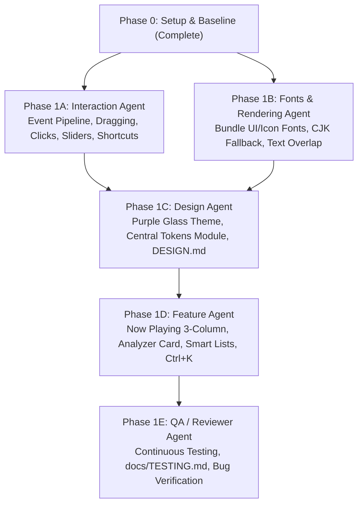

# Umbra Repair & Redesign Master Plan

## ✦ 1. Framework & Architecture Detection
*(Detected from codebase inspection — never assumed)*

- **GUI Framework**: `egui` v0.29.1 via `eframe` v0.29.1
- **Event Loop & Windowing**: `winit` v0.30 (integrated through `egui-winit`)
- **Graphics Backend**: OpenGL ES / Desktop GL via `glow` / `egui_glow` / `glutin`
- **Audio Pipeline**: `rodio` v0.19 (`cpal` WASAPI backend + `symphonia` decoders for FLAC, MP3, WAV, Vorbis, AAC)
- **Metadata & Tags**: `lofty` v0.21 (pure Rust audio tag parser & picture extractor)
- **Database Backend**: `rusqlite` v0.32 (bundled SQLite)
- **Window Configuration**: Frameless window (`with_decorations(false)`, `with_transparent(true)`)

---

## ✦ 2. Master Phase Breakdown

---

## ✦ 3. Detailed Agent Assignments

### Phase 1A: Interaction Agent (`agents/interaction/agent.md`)
*Single Job: Audit and fix the entire event pipeline from root causes.*
- **Titlebar Hit-Testing**: Allocate draggable rect on the custom titlebar calling `ctx.send_viewport_cmd(egui::ViewportCommand::StartDrag)`. Add double-click to maximize/restore.
- **Window Controls**: Fix Minimize (`ViewportCommand::Minimized(true)`), Maximize (`ViewportCommand::Maximized(bool)`), and Close (`ViewportCommand::Close`).
- **Interactive Sliders**: Custom continuous seek bar with single-click jump and dragging; responsive volume slider.
- **Scroll & Clicks**: Enable independent sidebar vertical scrolling; double-click row playback; hover & click feedback.
- **Keyboard Shortcuts**: Global listener in `UmbraApp::update` for `Space` (play/pause), `←`/`→` (seek ±5s), `↑`/`↓` (volume ±5%), `M` (mute), `S` (shuffle), `R` (repeat), and `Ctrl+K` (search focus).
- **Deliverable**: Fixed event pipeline + manual testing checklist in `docs/TESTING.md`.

### Phase 1B: Fonts & Rendering Agent (`agents/fonts-rendering/agent.md`)
*Single Job: Eliminate empty boxes ("tofu"), bundle fonts & symbols, and fix layout overlaps.*
- **CJK Font Fallbacks**: Configure `egui::FontDefinitions` with Japanese, Korean, and Chinese fallback glyphs (Segoe UI, Yu Gothic, Meiryo, or MS Gothic) so Japanese track names like `君はロックを聴かない` and lyrics render with zero missing glyphs.
- **Icon Glyphs**: Bundle sharp UI icon glyphs for media playback (play, pause, shuffle, repeat, heart, volume, search).
- **Layout Overlap Fix**: Redesign sidebar layout so the track/playlist count never overlaps the Settings/About buttons.
- **Window Height Fill**: Remove hardcoded height subtractions (`available_height() - 75.0`); ensure panels dynamically fill available window bounds.

### Phase 1C: Design Agent (`agents/design/agent.md`)
*Single Job: Implement purple glass theme matching `docs/reference/target-umbra.png` via a central theme module.*
- **Central Theme Module**: Refactor `src/ui/theme.rs` into centralized design tokens (colors, padding, radii, borders, drop shadows).
- **Target Aesthetic Alignment**: Replace amber/orange with dark charcoal purple (`#0b0914` canvas, `#141022` panels, `#b388ff` neon accents, translucent borders `rgba(180, 140, 255, 0.15)`).
- **Glassmorphism**: Add specular glass highlights, subtle drop shadows, and soft rounded corners across cards and playerbar.

### Phase 1D: Feature Agent (`agents/feature/agent.md`)
*Single Job: Implement missing target screens and navigation features (after A-C are merged).*
- **Now Playing 3-Column View**:
  - Left: Large rounded album art (`260x260px`) with ambient shadow, title, artist, year, format badges (`FLAC`, `24-BIT 48 KHZ`, plays).
  - Center: Synced lyrics with bright active line and faded non-active lines; click-to-seek.
  - Right: Audio Analyzer card with Peak, LUFS, Dynamic Range, L/R meters, and live 20Hz-20kHz spectrum.
- **Top Bar Upgrades**: Back/Forward history navigation buttons; centered search box with `Ctrl+K` shortcut hint.
- **Smart Playlists**: Recently Played, Most Played, Recently Added, Favorites, Never Played, Random Discovery.

### Phase 1E: QA / Reviewer Agent (`agents/qa-reviewer/agent.md`)
*Single Job: Continuous review, verification, and bug hunting.*
- Review diffs for each handoff against `.agent/rules/protocol.md`.
- Run `cargo check`, `cargo clippy`, and `cargo test`.
- Launch live app, walk through `docs/TESTING.md`, test local music files (`C:\music\Muse`).
- Hunt for edge cases: audio glitches, panics, `unwrap()` on untrusted data, UI thread blocking, seeking latency, memory leaks.

---

## ✦ 4. Phase 2: User Enhancements (Window Resizing, High-Contrast Badges & Album Cover Art)

### Phase 2A: Frameless Window Edge & Corner Resizing (`interaction`)
- Implement 7px border margin hit-testing in `src/ui/resize.rs` for all 8 directions.
- Wire directional `CursorIcon` and `ViewportCommand::BeginResize`.
- Add visual diagonal glass grip handle in bottom-right playerbar.
- Prevent titlebar drag interference on top border.

### Phase 2B: High-Contrast FLAC & Format Badges (`fonts-rendering`)
- Implement `format_badge` in `src/ui/components.rs` with luminous warm amber fill/border for lossless and bright lilac for lossy.
- Align song table header and row entries with dedicated 60px format slots.
- Upgrade format badges in playerbar, now playing, home favorites, and playlist views.

### Phase 2C: Album Cover Art Extraction, Caching & Rendering (`orchestrator`)
- Extract embedded album artwork tags via `lofty` and local directory image files (`cover.jpg`, `folder.jpg`).
- Persistent disk caching in `%APPDATA%\Umbra\art_cache\<hash>.bin`.
- Decode and downsample to max 512x512 with `image` and upload into GPU textures in `src/ui/art.rs`.
- Wire textures into Now Playing card, Playerbar mini thumbnail, Albums grid cards & header, and Home view.

### Phase 2D: QA Regression & Release Build (`qa-reviewer`)
- Execute full test suite (26 tests).
- Live execution test of `umbra.exe` testing all new features and verifying stability.

---

## ✦ 5. Phase 3: Parallel Deep Debugging, Zero-Emoji Vector Icon System, Real-Time Audio DSP & Dashboard Overhaul

### Phase 3A: Real-Time Audio DSP, 2048 Hann FFT, Live dBFS & Queue Progression (`audio-dsp-debugger`)
- Non-blocking PCM sample tap (`TapSource`) buffering into an 8192-sample stream.
- 2048-sample Hann-windowed FFT via `rustfft` mapped to 20Hz–20kHz logarithmic frequency bins with dBFS temporal decay.
- Real time-domain scope buffer, stereo L/R RMS and True Peak dBFS meters. Zero fake waves.
- Robust queue management: populates full queue context from any view, seamless Next/Prev, pins active track on shuffle, automatic track advance on EOF, Repeat (Off/All/One).

### Phase 3B: Zero-Emoji Vector/SVG Icon System & Sidebar Layout Overhaul (`svg-sidebar-specialist`)
- Pure vector icon rendering system in `src/ui/icons.rs` with 46 Feather/Lucide-style icons rendered crisply onto `egui::Painter`.
- 100% codebase emoji purge across all views, controls, and labels.
- Sidebar widened to fixed 240px with proper padding (12, 10).
- STREAM items formatted with compact pill badge to prevent collision.
- High-contrast active navigation pill with glowing accent background/border, bright lavender text, and 3px left indicator bar.

### Phase 3C: Responsive Grid Auto-Wrapping, Umbra Home Dashboard & Playerbar (`grid-playerbar-specialist`)
- Responsive auto-wrapping grid for Albums, Artists, Genres, Playlists with dynamic column calculation.
- Complete authentic Umbra Home Dashboard: Hero banner + Quick Actions, 4-card stats grid, Recently Played shelf, Recently Added & Most Played sections, Favorites grid.
- Restructured 3-column Player Bar (Left snippet, Center transport & scrub bar, Right mini spectrum & controls).
- Studio-grade proportional logarithmic frequency axis for Audio Analyzer (`20Hz...20kHz`).

### Phase 3D: Integration & Regression Verification (`integration-verifier`)
- Comprehensive codebase emoji audit (0 emojis).
- `cargo check`, `cargo clippy --all-targets -- -D warnings`, `cargo test --all`.
- Release build generation and live responsiveness verification.
- Bi-directional repo sync.

- Record all defects in `BUGS.md`.
