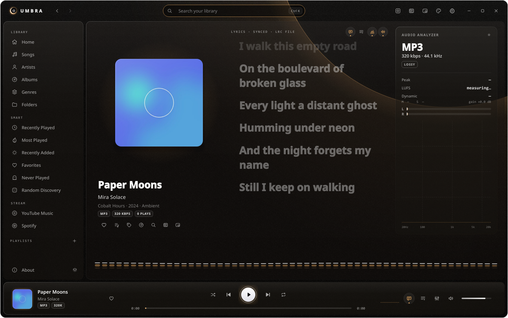

# Umbra — music, in the dark.

A high-performance, local-first lossless music player for Windows rewritten in **pure Rust** with a calm, dark purple glass aesthetic.



---

## ✦ Highlights

- **Rust Audio Engine**: Powered by `rodio` and `symphonia` with real-time PCM audio stream tapping. Zero audio stuttering with an 8192-sample non-blocking buffer.
- **Studio-Grade Real-Time Visualizer**:
  - 2048-sample forward Hann-windowed FFT via `rustfft`.
  - Logarithmic frequency mapping from `20Hz` to `20kHz` with +3dB/octave pink-noise compensation and dBFS temporal smoothing/gravity decay.
  - Real-time time-domain oscilloscope buffer and live Left/Right channel RMS & Peak dBFS meters. Zero fake math waves.
- **100% Vector Icon Architecture**:
  - Completely free of Unicode emoji and symbol placeholders.
  - 46 custom vector icons (Lucide / Feather style) rendered crisply directly on `egui::Painter` with dynamic DPI scaling.
- **Glassmorphic Purple UI**:
  - Centralized design tokens in `src/ui/theme.rs`.
  - Obsidian canvas (`#0b0914`), translucent frosted glass cards, neon violet accent (`#b388ff`), and warm amber lossless format badges (`#ffb25c`).
- **Responsive Layout & Dynamic Grids**:
  - Fixed 240px left sidebar with smooth independent scrolling and full-width library counter.
  - Responsive auto-wrapping grid (`minmax(165px, 1fr)`) for Albums, Artists, and Genres with strict 1:1 square cover art aspect ratios.
  - Full Umbra Home dashboard with Quick Actions (`Play All`, `Shuffle Library`, `Scan Folder`), 4-card statistics grid, and Recently Played shelf.
  - 3-column docked Player Bar with album art snippet, transport controls, continuous scrubbing seekbar, and mini spectrum visualizer.
- **Full Queue Progression**:
  - Sequential playback, non-repeating shuffle permutation, and repeat modes (`Off`, `All`, `One`).
  - Seamless automatic track advancement on EOF.
- **Cover Art & CJK Typography**:
  - Embedded metadata picture extraction via `lofty` with asynchronous decoding on background worker threads.
  - Zero UI thread blocking.
  - Native Windows CJK font fallbacks for Japanese, Korean, and Chinese tracks and synced lyrics.
- **Frameless Window Management**:
  - Custom titlebar drag region, double-click maximize/restore, minimize, and close.
  - 7px border margin hit-testing for 8-direction OS window resizing and bottom-right glass grip handle.

---

## ✦ Keyboard Shortcuts

| Shortcut | Action |
|---|---|
| `Space` | Play / Pause |
| `←` / `→` | Seek ±5 seconds |
| `↑` / `↓` | Volume ±5% |
| `M` | Toggle Mute |
| `S` | Toggle Shuffle |
| `R` | Cycle Repeat Mode (`Off` → `All` → `One`) |
| `Ctrl + K` | Focus Global Search |
| `F11` | Toggle Fullscreen |

---

## ✦ Building & Running

### Prerequisites
- [Rust toolchain](https://rustup.rs/) (1.80+ recommended, edition 2021)
- Windows 10 or 11

### Quick Start
```powershell
# Run in development mode
cargo run

# Build optimized release binary
cargo build --release

# Run release build
.\run.bat
# or directly:
.\umbra.exe
```

### Running Tests
```powershell
cargo test --all
cargo clippy --all-targets -- -D warnings
```

---

## ✦ Architecture Overview

```
src/
├── main.rs                 # Application entry point & frameless viewport configuration
├── config.rs               # Persistent user preferences (%APPDATA%\Umbra\config.json)
├── audio/
│   ├── engine.rs           # Rodio sink wrapper & non-blocking TapSource PCM interceptor
│   ├── visualizer.rs       # 2048-sample Hann FFT, log dBFS bins, scope & stereo meters
│   └── mod.rs              # PlayerController & queue management
├── library/
│   ├── db.rs               # SQLite library storage & queries (rusqlite)
│   ├── scanner.rs          # Directory walker & audio metadata extraction (lofty)
│   └── model.rs            # Track, Album, Artist data structures
├── lyrics/
│   ├── lrc.rs              # Synced LRC parser with timestamp offsets
│   └── lrclib.rs           # Asynchronous LRCLIB client
└── ui/
    ├── icons.rs            # 100% vector icon component library
    ├── theme.rs            # Design tokens & frosted glass styling frames
    ├── components.rs       # Format badges, buttons, and custom widgets
    ├── playerbar.rs        # 3-column docked bottom player bar & mini visualizer
    ├── sidebar.rs          # 240px navigation sidebar with high-contrast pills
    ├── titlebar.rs         # Custom frameless titlebar with window controls & search
    ├── resize.rs           # Frameless window perimeter hit-testing & resize handling
    ├── art.rs              # Asynchronous cover art loader & texture cache
    ├── fonts.rs            # CJK font fallback configuration
    ├── shortcuts.rs        # Global hotkey event listener
    └── views/              # Home, Now Playing, Songs, Albums, Artists, Playlists, Folders, Settings, About
```

---

## ✦ License

Released under the [MIT License](LICENSE).
