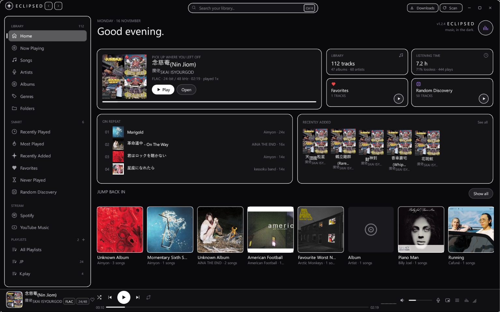
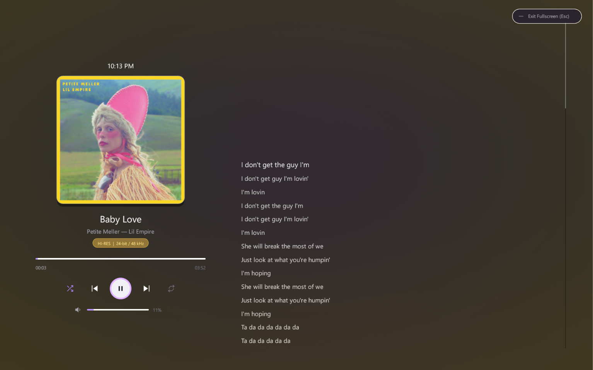
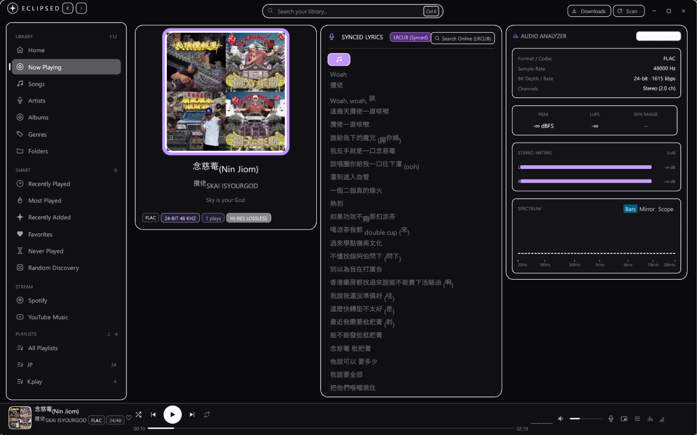
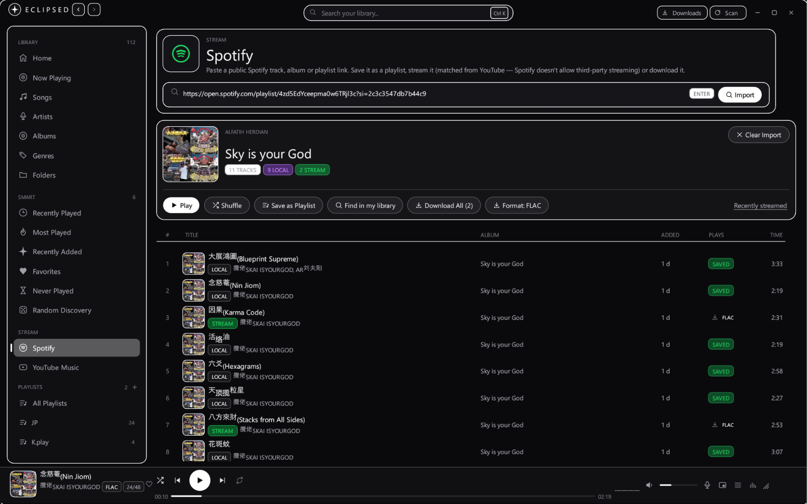
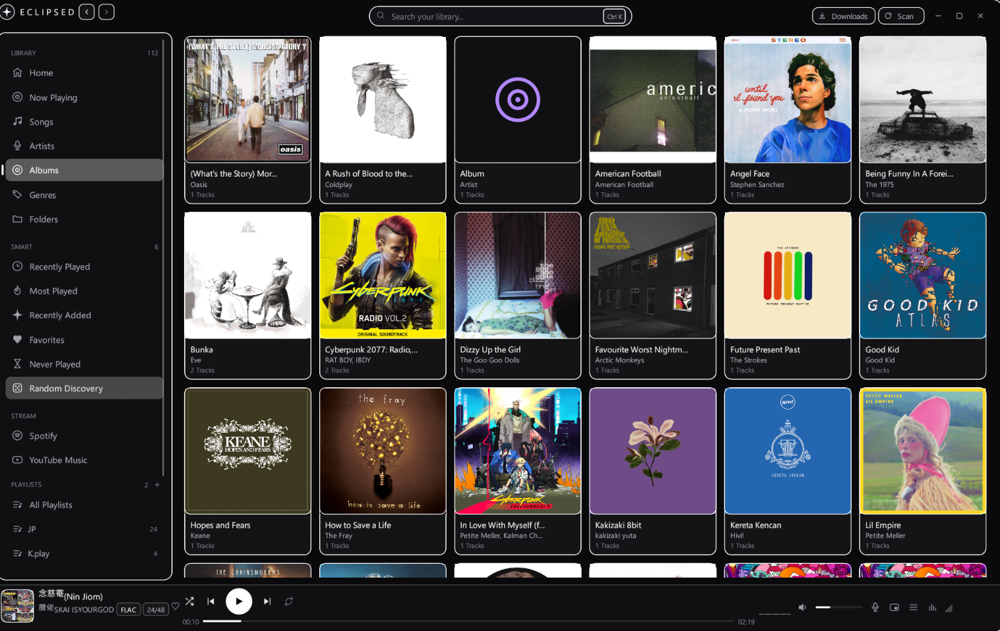
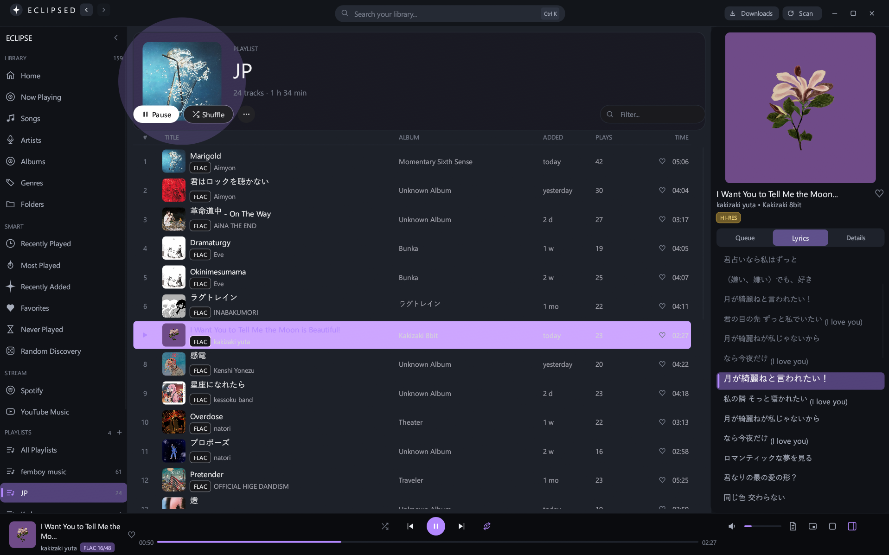

# Eclipse — music, in the dark.

[](https://github.com/Caly-sys/Eclipse/releases/tag/v1.2.6)
[](https://github.com/Caly-sys/Eclipse/releases)
[](https://www.rust-lang.org)
[](LICENSE)

A high-performance music player for Windows written in Rust with a calm, dark purple glass aesthetic.

> **Project Status**: **v1.2.6 Active Release — The UI Rework** — Feishin-style matte-slate 3-column bento layout, dynamic palette theming, real-time PCM analyzer, LRCLIB cloud lyrics modal, native Win32 mini-player rounding, and hardened streaming backend.

---

## ✦ Preview

### Home Dashboard
*Bento grid layout featuring "Pick up where you left off", listening statistics, on-repeat tracks, and horizontal album shelf.*



<br/>

### Cinematic Fullscreen Mode
*Immersive ambient blurred background, live 12-hour local clock, crisp rounded artwork clipping, high-contrast HI-RES audio badges, and smoothly auto-centered synchronized lyrics (`F11` / `Esc`).*



<br/>

### Now Playing & Real-Time PCM Analyzer
*Synchronized LRCLIB lyrics with smooth autoscrolling, stereo peak meters, and real-time logarithmic FFT spectrum analyzer.*



<br/>

### Spotify Public Link Importer
*Zero-login public link importer with local library matcher, custom playlist saver, and embedded YouTube streaming.*



<br/>

### Albums Library
*Auto-wrapping grid with high-resolution embedded cover art decoding and square aspect ratios.*



<br/>

### Playlist & Multi-Column Track Table
*Playlists with hero header, duration metrics, format badges, and relative timestamps.*



---

## ✦ Highlights

- **Local Audio Engine**: High-fidelity decoding for lossless (FLAC, WAV, ALAC) and lossy (MP3, Vorbis, AAC) formats, powered by Rodio and Symphonia.
- **In-Memory Audio Analyzer**: Real-time logarithmic FFT visualizer, stereo peak meters, and oscilloscope driven by in-memory PCM audio buffers.
- **Synced Lyrics & Dynamic Artwork**: Real-time autoscrolling `.lrc` lyrics from LRCLIB and asynchronous embedded cover art decoding.
- **Dark Glass Interface**: Frameless, responsive desktop UI built with egui, custom vector iconography, and native Windows CJK font fallbacks.
- **Spotify Link Importer & Batch Downloader**: Paste public Spotify links to save playlists, match against local files, stream via YouTube, or batch download in Hi-Res FLAC/MP3/OPUS/M4A/WAV.
- **Cinematic Fullscreen & Floating Mini-Player**: Immersive full-viewport ambient experience with live clock (`F11` / `Esc`) and a unified floating desktop lyrics card.

---

## ✦ What's New in v1.2.6 — The UI Rework

### 🍱 Feishin-Style Matte-Slate Bento 3-Column Architecture
- **Layered Matte Charcoal Surfaces**: Completely overhauled visual architecture replacing wireframe borders with a refined matte surface hierarchy (`#12151A` bar surfaces, `#161A20` sidebars & inspector, `#1D2129` center viewport, and `#252A34` elevated cards).
- **Subtle 1px Structural Pane Seams**: Replaced harsh high-contrast white strokes with quiet, dark 1px pane dividers (`Color32::from_rgb(36, 41, 50)`) for crisp architectural separation.
- **Dynamic Bento Palette & Settings Theming**: Dynamic palette generator powered by active Settings Themes (`Ember`, `Verdant`, `Nebula`, `Glacier`, `Obsidian`, `Eclipse`) and Accent Colors.

### 🌌 Edge-to-Edge Home Ambient Gradient
- **Full-Bleed Center Glow**: Edge-to-edge 10-row multi-stop `egui::Mesh` blending from center slate into active theme accent color across the entire top header width with zero dark gutters.
- **Ease-Out Color Mathematics**: Calibrated lerp curve maintains pure RGB color vibrancy without dark grey muddying.

### 🎵 Restored Now Playing View & Enhanced Right Inspector
- **Real-Time PCM Spectrum Analyzer**: Restored dedicated Now Playing view with logarithmic FFT frequency visualizer and stereo peak meters.
- **LRCLIB Cloud Lyrics & Manual Search**: Interactive `Search Online (LRCLIB)` modal to query, preview, and apply synced lyrics on the fly.
- **High-Contrast Active Lyric Lines**: Enhanced readability across dark matte surfaces with crisp translucent highlight pill and gold badges.

### 🪟 Native Windows Pop-Out Mini-Player Rounding
- **DWM Native Window Rounding**: Native Win32 `DwmSetWindowAttribute` / `CreateRoundRectRgn` rounded corners on the borderless mini-player viewport (`HWND`), eliminating dark rectangular corner artifacts on Windows 10/11.

### 🛡️ Backend Reliability & Race Condition Fixes
- **Track Skipping Lyrics Race Elimination**: Generational request ID tracking on async LRCLIB requests ensures late-arriving lyrics from skipped tracks never overwrite the active track.
- **Downloader Mutex Poisoning Recovery**: All download worker queues safely recover from poisoned mutex state instead of crashing the process on panic.
- **Safe HTML Entity Decoding**: Hardened entity parsing for YouTube metadata strings.

---

## ✦ What's New in v1.2.5

### 🎧 Multi-Format Audio Downloader
- **Format Flexibility**: Switch freely between **FLAC** (default, 24-bit / 48 kHz Hi-Res probing), **MP3** (320 kbps), **OPUS** (transparent speech/music codec), **M4A** (AAC), and uncompressed **WAV**.
- **Persistent Preferences**: Configure your default download format once in **Settings > Streaming**; Eclipse retains your choice across launches.
- **Right-Click Quick Selection**: Context-menu format overrides directly on any track, album, or playlist download trigger for instant on-the-fly format selection.

### ⚡ Whole Playlist & Album Batch Downloading
- **One-Click Batch Downloads**: One-click **"Download All"** on imported Spotify playlists/albums and **"Download Missing"** in saved playlists to fetch only tracks not yet in your local library.
- **Bounded Concurrency Engine**: Managed queue with `MAX_CONCURRENT_DOWNLOADS = 2` to prevent network socket exhaustion, rate limiting, and thread starvation.
- **Full Queue Governance**: Real-time per-track progress bars with global **Cancel All** and **Retry Failed** controls.

### 🎨 Self-Healing Artwork & Genre Metadata
- **Expanded Codec Support**: Full FLAC Picture block extraction and modern WebP image decoding for comprehensive album art coverage.
- **Spotify oEmbed Cover Resolution**: Automatic cover art resolution for `STREAM` tracks without requiring user accounts or API tokens.
- **Automated Metadata Backfill**: Intelligent online cover art and genre enrichment powered by iTunes Search and Deezer APIs for untagged tracks.
- **Permanent Tag Embedding**: Enriched tags and high-resolution cover art are permanently embedded directly back into local audio files via `lofty`.
- **Frosted-Glass Genre Grid**: Dedicated Genre view with a responsive card grid and master-detail drilldown into matching tracks and albums.

### 🚀 Optimized Stream Caching & Queue Pre-Buffering
- **Zero Console Flashing**: Headless Windows process execution (`CREATE_NO_WINDOW`) for completely silent background extraction.
- **500 MB LRU Stream Cache**: High-speed local cache providing **0ms instant cache hits** on repeated stream playbacks.
- **Active Request Deduplication**: Prevents redundant simultaneous network fetches for the same audio track.
- **Lookahead Pre-Buffering**: Silently pre-buffers the next track in the queue in the background, featuring seamless in-flight promotion when skipping forward.
- **Storage Management**: Dedicated **Clear Stream Cache** action with live disk usage indicators in **Settings > Streaming**.

### 🌌 Cinematic Fullscreen Mode (`F11` / `Esc`)
- **Immersive Ambient Backdrop**: GPU-cached ambient blurred album art backdrop dynamically matching current track colors.
- **Live Local Clock**: Subtle 12-hour local clock centered gracefully above the album cover, updating live.
- **Crisp Rounded Artwork**: Precision-clipped album artwork card with high-contrast `HI-RES` audio badges.
- **Centered Transport & Synced Lyrics**: Centered playback controls with seamlessly auto-centered synchronized lyrics supporting local ID3/Vorbis tags, `.lrc` sidecars, and LRCLIB cloud streams. Toggle with `F11` or exit with `Esc`.

### 🪟 Redesigned Floating Mini-Player (PiP)
- **Unified Dark-Glass Card**: Frameless translucent pop-out card engineered to float above any desktop workspace.
- **Centered Live Lyrics Strip**: Integrated single-line live lyrics strip synchronized with real-time playback.
- **Compact Controls**: Rounded cover art thumbnail, smooth mini seekbar, volume controls, and pinned top-right close / dock buttons.

---

## ✦ Installation & Setup

Eclipse is portable and self-contained. It requires no administrative installers or background updater daemons.

### Option 1: Standalone Portable Executable (Recommended)

1. Download the latest release package (`eclipse.exe` or `eclipse-v1.2.6-windows-x64.zip`) from [GitHub Releases](https://github.com/Caly-sys/Eclipse/releases).
2. Move `eclipse.exe` into any preferred directory (such as `%LOCALAPPDATA%\Programs\Eclipse`).
3. Double-click `eclipse.exe` to launch.

#### Release SHA-256 Checksums (v1.2.6)
| File | SHA-256 Checksum |
|---|---|
| `eclipse.exe` (x64 MSVC) | `33F1A3DA522BC529917FB0D22A846A1D1F21FF5D1CE97C2EAC5877D1618F5DB3` |
| `eclipse-v1.2.6-windows-x64.zip` | `D3AA9578E2462957EE742DFAE624BE48D00385989CD53583CA95382B93BE2A1E` |

> [!NOTE]
> **Windows Defender SmartScreen Notice:**
> Because Eclipse is an open-source binary without a commercial code-signing certificate, Windows SmartScreen may display a *"Windows protected your PC"* prompt on first launch. Click **More info** → **Run anyway** to start the application.

> [!TIP]
> **Streaming & Audio Download Dependencies:**
> Online search, streaming, and audio downloading (`FLAC`, `MP3`, `OPUS`, `M4A`, `WAV`) require `yt-dlp` and `ffmpeg`. If you don't already have them installed, run:
> ```powershell
> winget install yt-dlp Gyan.FFmpeg
> ```
> *(Or place `yt-dlp.exe` and `ffmpeg.exe` directly in the same directory as `eclipse.exe` or anywhere in your system `PATH`.)*

---

### Option 2: Building from Source

#### Prerequisites
- **Rust Toolchain**: Rust 1.80+ (`stable-x86_64-pc-windows-msvc`), Visual Studio C++ Build Tools (MSVC with Windows SDK), and Git.
- **yt-dlp & FFmpeg**: Required for online streaming search, caching, and audio extraction (`winget install yt-dlp Gyan.FFmpeg` or `scoop install yt-dlp ffmpeg`).

```powershell
# 1. Clone the repository
git clone https://github.com/Caly-sys/Eclipse.git
cd Eclipse

# 2. Run unit tests
cargo test --bin eclipse

# 3. Build optimized release binary (statically links CRT via .cargo/config.toml)
cargo build --release

# 4. Launch Eclipse
.\target\release\eclipse.exe
```

---

## ✦ Data & Configuration Paths

Eclipse keeps all user configuration, local SQLite indexing, and cached lyrics isolated inside your user profile:

| Path | Description |
|---|---|
| `%APPDATA%\Eclipse\settings.json` | Persistent user settings: audio outputs, crossfade, volume leveling, monitored folders, themes, and download preferences. |
| `%APPDATA%\Eclipse\library.db` | High-performance SQLite database storing indexed tracks, album metadata, listening stats, and playlists. |
| `%APPDATA%\Eclipse\lyrics_cache\` | Offline disk cache for plain and synchronized `.lrc` lyrics fetched from LRCLIB. |
| `%APPDATA%\Eclipse\stream_cache\` | 500 MB LRU disk cache for pre-buffered and streamed audio tracks. |

To reset the player to a fresh state, exit the application and delete the `%APPDATA%\Eclipse` directory.

---

## ✦ Usage

### 1. Launching Eclipse
- Run `.\run.bat` or `.\eclipse.exe` directly.
- The player launches in a frameless glass window. Drag anywhere on the empty titlebar to move the window, or drag borders/corners to resize.

### 2. Scanning Your Music Library
- On the **Home** dashboard, click **Scan Folder** in the Quick Actions banner, or navigate to **Settings** in the sidebar → **Library Monitored Folders** and click **Add Folder**.
- Select the directory containing your audio files (`FLAC`, `WAV`, `ALAC`, `MP3`, `OGG`, `AAC`, `M4A`).
- Eclipse crawls your files, extracts metadata and embedded cover art asynchronously via `lofty`, and indexes the library in SQLite.

### 3. Browsing Your Music
- **Home**: Dashboard showing library statistics, quick actions, Recently Played shelf, and top played tracks.
- **Songs**: High-density sortable list with track titles, artists, albums, duration, and format badges (`FLAC`, `WAV`, `ALAC`, `MP3`, `OGG`, `AAC`).
- **Albums**: Auto-wrapping grid of square album covers. Click an album to open its detail view and tracklist.
- **Artists & Folders**: Browse by artist discography or navigate disk folder hierarchies directly.
- **Genres**: Responsive card grid with master-detail drilldown into tracks and albums by genre.
- **Smart Playlists**: Quick access to `Recently Played`, `Most Played`, `Recently Added`, `Favorites`, `Never Played`, and `Random Discovery`.
- **Search (`Ctrl + K`)**: Instant global search across tracks, artists, and albums.

### 4. Playback & Queue Controls
- Double-click any song or click **Play All** on an album or view to start playback.
- **Play / Pause**: Click the transport button or press `Space`.
- **Next / Previous**: Skip between tracks with transport buttons or shortcuts. Shuffle mode uses a non-repeating permutation.
- **Repeat Modes**: Cycle between Repeat Off, Repeat All (loops playlist), and Repeat One (loops active track).
- **Seeking**: Click or drag directly on the seekbar for smooth scrubbing.
- **Volume**: Use the volume slider or mouse scroll wheel over the volume area.
- **Queue Drawer**: Click the queue button in the player bar to view upcoming songs, jump to any track, or inspect details.

### 5. Synced Lyrics & Audio Analyzer
- Switch to the **Now Playing** tab (or click the album art thumbnail in the bottom player bar):
  - **Left**: Large cover art display with ambient glow and track metadata badges.
  - **Center**: Synced `.lrc` lyrics with real-time autoscrolling. Click any lyric line to jump directly to that timestamp.
  - **Right**: Real-time in-memory PCM Audio Analyzer showing format specifications, live Left/Right channel stereo peak meters, and a live logarithmic spectrum visualizer.

### 6. Fullscreen & Mini-Player Modes
- **Cinematic Fullscreen**: Press `F11` to enter an immersive, ambient full-viewport view with centered album art, live clock, and synced lyrics. Press `Esc` or `F11` to exit.
- **Floating Mini-Player**: Click the pop-out Picture-in-Picture icon in the player bar to detach Eclipse into a sleek dark-glass desktop widget with live lyrics.

---

## ✦ Streaming, Importer & Downloader

Eclipse includes a public **Spotify Link Importer**, integrated **YouTube Music** streaming, and a high-fidelity **Multi-Format Audio Downloader** alongside your local library.

### How It Works

1. **Paste a Public Spotify Link**:
   - Copy any public Spotify track, album, or playlist link (`https://open.spotify.com/...` or `spotify:...`).
   - Paste it into the Spotify importer bar in Eclipse.
2. **Metadata Extraction**:
   - Eclipse parses the link and retrieves track titles, artists, album names, durations, and cover art URLs from public embed and oEmbed endpoints.
   - **No Spotify account or developer credentials required.**
3. **Local Library Matching**:
   - Click **Find in my library**: Eclipse compares the imported tracks against your indexed local music files.
   - Uses fuzzy matching with CJK/Unicode normalization, punctuation stripping, and duration tolerance.
   - If an imported track exists locally, Eclipse marks it with a `LOCAL` badge and plays your local file instead of streaming.
4. **Save As Custom Playlist**:
   - Click **Save all as playlist**: Eclipse stores the tracklist directly into your local SQLite database as an Eclipse playlist.
5. **Matched YouTube Playback**:
   - For tracks not found in your local collection, Eclipse queries the YouTube Data API v3 and plays matching tracks via YouTube's official embedded web player.
6. **Multi-Format Batch Downloading**:
   - Click **Download All** or **Download Missing** to queue downloads in your chosen format (FLAC, MP3, OPUS, M4A, WAV).
   - Songs are tagged, given high-resolution cover art, and saved directly to your local music directory.

---

### Capabilities Matrix

| Feature / Capability | Local Playback | Spotify Public Link Import | YouTube Music Stream | Multi-Format Downloader |
|---|---|---|---|---|
| **Audio Pipeline** | In-process Rodio/Symphonia engine | Metadata import + local playback / YouTube stream | Official embedded webview player | Background headless downloader (`CREATE_NO_WINDOW`) |
| **Supported Codecs** | FLAC, WAV, ALAC, MP3, Vorbis (OGG), AAC (M4A) | Plays local file if matched | AAC / Opus (via embedded player) | FLAC (24-bit Hi-Res), MP3 (320k), OPUS, M4A, WAV |
| **FFT Spectrum Analyzer** | **Available** (Real-time in-memory PCM tap) | **Available** when playing local matched file | *Not available for remote streams* (badge displayed) | **Available** once downloaded to local |
| **Account / Key Requirement** | **None** (Offline playback; optional lyrics lookup) | **None** (Public embed metadata) | Free Google account (for YouTube API key) | **None** |
| **Credentials Storage** | *None required* | *None required* | Stored in Windows Credential Manager | *None required* |

> [!NOTE]
> **Why is the Audio Analyzer exclusive to local files?**  
> Eclipse's real-time spectrum visualizer and stereo peak meters tap directly into the uncompressed in-memory PCM audio stream decoded by Rodio. Remote streaming playback executes through an embedded player container where raw PCM frames are not exposed to the local application. For streams, Eclipse displays a `STREAM` badge.

---

### YouTube Music API Key Setup

Eclipse uses the Google YouTube Data API v3 to search tracks and resolve stream matches:

1. Follow the [Google Cloud YouTube Data API v3 Setup Guide](https://developers.google.com/youtube/v3/getting-started) to create a project and generate an API key.
2. In Eclipse, open **Settings** in the sidebar → **Streaming** tab, paste your key, and click **Save Key & Connect**. The key is stored in the Windows Credential Manager.

> [!IMPORTANT]
> **API Quota Consideration:**  
> Google provides a default free quota of **10,000 units per day**. Each YouTube search query costs **100 units** (approximately ~100 search queries per day). Eclipse caches search matches in SQLite (`stream_match_cache`) to avoid repeated queries on replay, but importing playlists with many unmatched tracks will consume quota accordingly.

---

## ✦ Network & Privacy

- **Local Playback**: Audio decoding and playback require no network connection. The only outbound request during local playback is an optional lyrics lookup from LRCLIB. This can be toggled off in **Settings > Lyrics** (`Auto-Fetch from LRCLIB`). When disabled, local playback makes zero network connections. Zero telemetry, zero analytics.
- **Spotify Importer**: Makes outbound HTTPS GET requests to `open.spotify.com` to fetch public embed metadata. No user credentials, cookies, or accounts are transmitted.
- **YouTube Streaming**: Queries Google APIs for search and resolves video embeds. Your YouTube API key is stored in the Windows Credential Manager.
- **LRCLIB Lyrics**: Queries `lrclib.net` over HTTPS using track titles and artists to fetch plain and synchronized lyrics. Results are stored in `%APPDATA%\Eclipse\lyrics_cache\` to minimize repeated queries.
- **Metadata Backfill**: Queries iTunes Search and Deezer public APIs for missing cover art and genre tags when requested.

---

## ✦ Known Issues & Limitations

- **WebView2 Runtime Requirement**: Streaming playback relies on the Microsoft Edge WebView2 runtime. It is pre-installed on Windows 11 and modern Windows 10, but stripped Windows installations may need the [Microsoft WebView2 Bootstrapper](https://developer.microsoft.com/en-us/microsoft-edge/webview2/).
- **Playlist Truncation**: Public Spotify embed endpoints return a maximum of 100 tracks per playlist. Playlists exceeding 100 tracks will display the first 100 tracks.
- **Daily Search Quota**: Google Cloud free projects have a 10,000 unit daily limit (~100 search queries). Once exhausted, stream searches pause until Google resets the daily quota.
- **Stream Audio Analyzer**: Real-time FFT visualization is not supported for remote YouTube streams due to browser sandbox audio isolation.

---

## ✦ Contributing

Contributions, bug reports, and suggestions are welcome!

1. Fork the repository and create a descriptive branch: `git checkout -b feature/my-feature`.
2. Ensure all tests pass: `cargo test --all`.
3. Ensure no compiler or linter warnings: `cargo clippy --all-targets -- -D warnings`.
4. Follow Rust formatting conventions: `cargo fmt --check`.
5. Open a Pull Request with a clear description of your changes.

---

## ✦ Keyboard Shortcuts

| Shortcut | Action |
|---|---|
| `Space` | Play / Pause |
| `←` / `→` | Seek ±5 seconds |
| `↑` / `↓` | Volume ±5% |
| `M` | Toggle Mute |
| `S` | Toggle Shuffle |
| `R` | Cycle Repeat Mode (`Off` → `All` → `One`) |
| `Ctrl + K` | Focus Global Search |
| `F11` / `Esc` | Toggle / Exit Cinematic Fullscreen |
| `Ctrl + Q` | Exit Application |

---

## ✦ Architecture Overview

```
src/
├── main.rs                 # Application entry point & frameless viewport configuration
├── config.rs               # User preferences & paths (%APPDATA%\Eclipse\settings.json)
├── audio/
│   ├── engine.rs           # Rodio sink wrapper & non-blocking TapSource PCM interceptor
│   ├── visualizer.rs       # In-memory PCM FFT, log dBFS bins, scope & stereo meters
│   └── mod.rs              # PlayerController & queue management
├── library/
│   ├── db.rs               # SQLite library storage & queries (rusqlite)
│   ├── scanner.rs          # Directory walker & metadata extraction (lofty)
│   └── model.rs            # Track, Album, Artist data structures
├── lyrics/
│   ├── lrc.rs              # Synced LRC parser with timestamp offsets
│   └── lrclib.rs           # Asynchronous LRCLIB client
├── streams/
│   ├── controller.rs       # Background worker actor for streaming & download queue
│   ├── downloader.rs       # Multi-format audio downloader & concurrency controller
│   ├── spotify_public.rs   # Public Spotify embed/oEmbed parser (zero login)
│   ├── matcher.rs          # CJK/Unicode fuzzy matcher against local library
│   └── playback.rs         # YouTube Data API matcher & embedded webview player
└── ui/
    ├── icons.rs            # 100% vector icon component library
    ├── theme.rs            # Design tokens & frosted glass styling frames
    ├── components.rs       # Format badges, buttons, and custom widgets
    ├── playerbar.rs        # Docked bottom player bar & mini visualizer
    ├── sidebar.rs          # Navigation sidebar
    ├── titlebar.rs         # Frameless titlebar with window controls
    ├── resize.rs           # Frameless window edge hit-testing & resizing
    ├── art.rs              # Asynchronous cover art loader & texture cache
    ├── fonts.rs            # CJK font fallback configuration
    ├── shortcuts.rs        # Global hotkey event listener
    ├── pip.rs              # Unified floating mini-player & desktop lyrics overlay
    └── views/              # Home, Now Playing, Fullscreen, Songs, Albums, Artists, Genres, Playlists, Streams, Settings, About
```

---

## ✦ Acknowledgements

Eclipse is an independent Rust reimplementation inspired by [Umbra](https://github.com/sadult/umbra), originally created by **Mersad Shahidi (@Bitologist)**.

The original project inspired the interface design, music-player concept, and overall aesthetic. The Rust implementation is independently developed and is not officially affiliated with the original author.

Original project: https://github.com/sadult/umbra  
Original licence: MIT License.

---

## ✦ Trademarks & Disclaimer

- **Spotify** is a trademark of Spotify AB.
- **YouTube** and **Google** are trademarks of Google LLC.
- Eclipse is an independent open-source project and is not affiliated with, endorsed by, or sponsored by Spotify AB or Google LLC.

---

## ✦ License

Released under the [MIT License](LICENSE).
For third-party dependencies, open-source attributions, and licenses, see [THIRD_PARTY_LICENSES.md](THIRD_PARTY_LICENSES.md).
