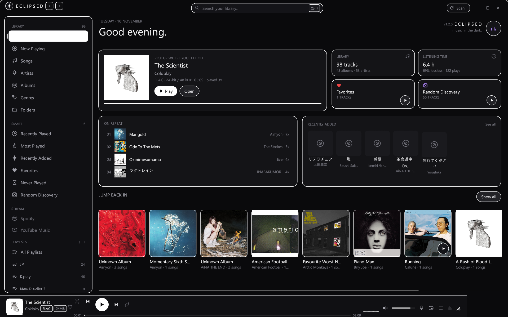
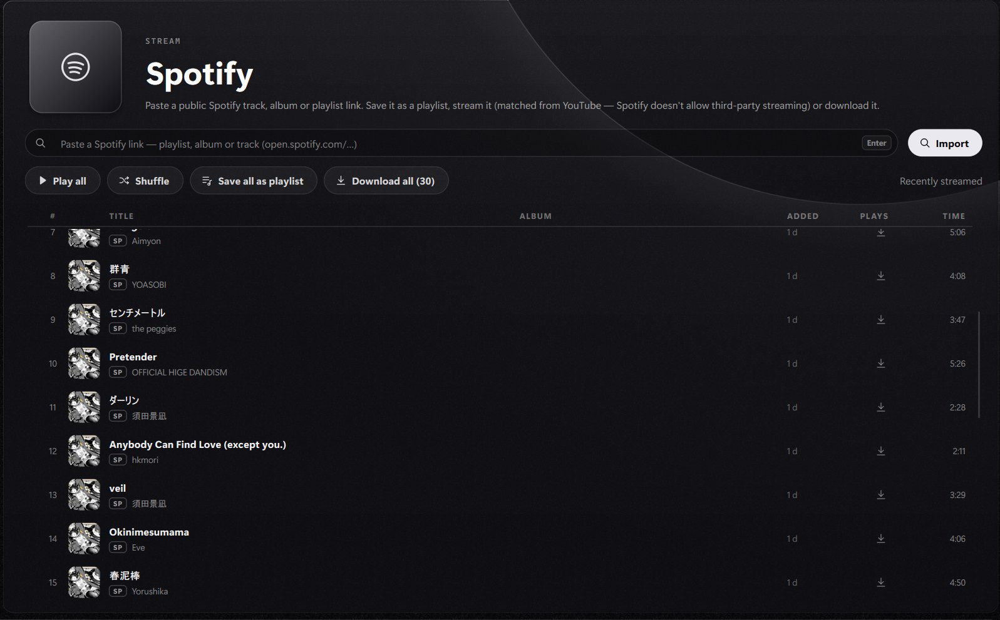
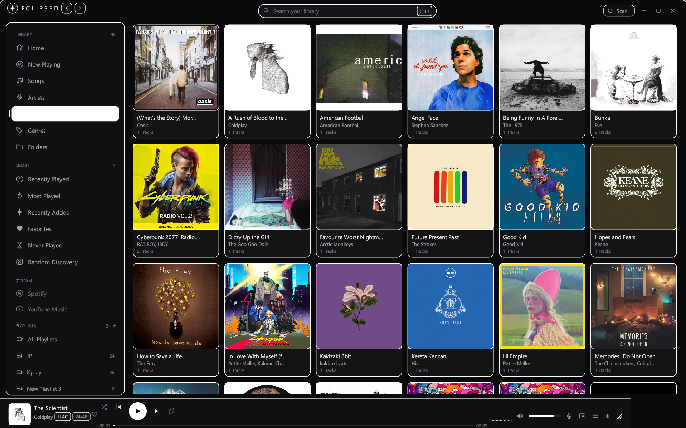
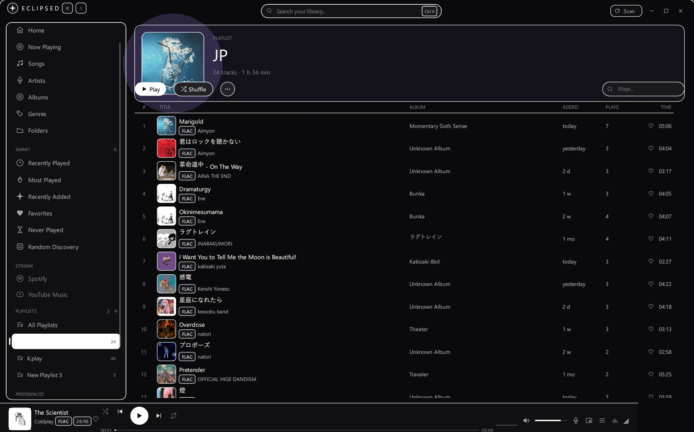

# Eclipse — music, in the dark.

A high-performance music player for Windows written in Rust with a calm, dark purple glass aesthetic.

> **Project Status**: **Beta** — Local lossless audio playback is fully functional; streaming features and link importing are in active development.

---

## ✦ Preview

### Home Dashboard
*Bento grid layout featuring "Pick up where you left off", listening statistics, on-repeat tracks, and horizontal album shelf.*



<br/>

### Spotify Public Link Importer
*Zero-login public link importer with local library matcher, custom playlist saver, and embedded YouTube streaming.*



<br/>

### Albums Library
*Auto-wrapping grid with high-resolution embedded cover art decoding and square aspect ratios.*



<br/>

### Playlist & Multi-Column Track Table
*Playlists with hero header, duration metrics, format badges, and relative timestamps.*



---

## ✦ Highlights

- **Local Audio Engine**: High-fidelity lossless decoding (FLAC, WAV, ALAC, MP3, OGG, AAC) powered by Rodio and Symphonia.
- **In-Memory Audio Analyzer**: Real-time logarithmic FFT visualizer, stereo peak meters, and oscilloscope driven by in-memory PCM audio buffers.
- **Synced Lyrics & Dynamic Artwork**: Real-time autoscrolling `.lrc` lyrics from LRCLIB and asynchronous embedded cover art decoding.
- **Dark Glass Interface**: Frameless, responsive desktop UI built with egui, custom vector iconography, and native Windows CJK font fallbacks.
- **Spotify Link Importer**: Paste public Spotify links to save playlists, match against local files, or stream via YouTube.

---

## ✦ Installation & Setup

Eclipse is portable and self-contained. It requires no administrative installers or background updater daemons.

### Option 1: Standalone Portable Executable (Recommended)

1. Download the latest release package (`eclipse.exe` or `eclipse-v1.2.2-windows-x64.zip`) from [GitHub Releases](https://github.com/Caly-sys/Eclipse/releases).
2. Move `eclipse.exe` into any preferred directory (such as `%LOCALAPPDATA%\Programs\Eclipse`).
3. Double-click `eclipse.exe` to launch.

#### Release SHA-256 Checksum (v1.2.2)
| File | SHA-256 Checksum |
|---|---|
| `eclipse.exe` (x64 MSVC) | `5CC2171A7873EC9B57238EEE2467429C5AD6881524A7A7E26F23131F61905809` |

> [!NOTE]
> **Windows Defender SmartScreen Notice:**
> Because Eclipse is an open-source binary without a commercial code-signing certificate, Windows SmartScreen may display a *"Windows protected your PC"* prompt on first launch. Click **More info** → **Run anyway** to start the application.

---

### Option 2: Building from Source

**Prerequisites:** Rust 1.80+ (`stable-x86_64-pc-windows-msvc`), Visual Studio C++ Build Tools (MSVC with Windows SDK), and Git.

```powershell
# 1. Clone the repository
git clone https://github.com/Caly-sys/Eclipse.git
cd Eclipse

# 2. Build optimized release binary (statically links CRT via .cargo/config.toml)
cargo build --release

# 3. Launch Eclipse
.\target\release\eclipse.exe
```

For full setup commands, `winget` scripts, test execution, and troubleshooting, see [docs/BUILDING.md](docs/BUILDING.md). For release packaging details, see [docs/RELEASING.md](docs/RELEASING.md).

---

## ✦ Data & Configuration Paths

Eclipse keeps all user configuration, local SQLite indexing, and cached lyrics isolated inside your user profile:

| Path | Description |
|---|---|
| `%APPDATA%\Eclipse\settings.json` | Persistent user settings: audio outputs, crossfade, volume leveling, monitored folders, and themes. |
| `%APPDATA%\Eclipse\library.db` | High-performance SQLite database storing indexed tracks, album metadata, listening stats, and playlists. |
| `%APPDATA%\Eclipse\lyrics_cache\` | Offline disk cache for plain and synchronized `.lrc` lyrics fetched from LRCLIB. |

To reset the player to a fresh state, exit the application and delete the `%APPDATA%\Eclipse` directory.

---

## ✦ Usage

### 1. Launching Eclipse
- Run `.\run.bat` or `.\eclipse.exe` directly.
- The player launches in a frameless glass window. Drag anywhere on the empty titlebar to move the window, or drag borders/corners to resize.

### 2. Scanning Your Music Library
- On the **Home** dashboard, click **Scan Folder** in the Quick Actions banner, or navigate to **Settings** in the sidebar → **Library Monitored Folders** and click **Add Folder**.
- Select the directory containing your audio files (`FLAC`, `WAV`, `ALAC`, `MP3`, `OGG`, `AAC`, `M4A`).
- Eclipse crawls your files, extracts metadata and embedded cover art asynchronously via `lofty`, and indexes the library in SQLite.

### 3. Browsing Your Music
- **Home**: Dashboard showing library statistics, quick actions, Recently Played shelf, and top played tracks.
- **Songs**: High-density sortable list with track titles, artists, albums, duration, and format badges (`FLAC`, `WAV`, `ALAC`, `MP3`, `OGG`, `AAC`).
- **Albums**: Auto-wrapping grid of square album covers. Click an album to open its detail view and tracklist.
- **Artists & Folders**: Browse by artist discography or navigate disk folder hierarchies directly.
- **Smart Playlists**: Quick access to `Recently Played`, `Most Played`, `Recently Added`, `Favorites`, `Never Played`, and `Random Discovery`.
- **Search (`Ctrl + K`)**: Instant global search across tracks, artists, and albums.

### 4. Playback & Queue Controls
- Double-click any song or click **Play All** on an album or view to start playback.
- **Play / Pause**: Click the transport button or press `Space`.
- **Next / Previous**: Skip between tracks with transport buttons or shortcuts. Shuffle mode uses a non-repeating permutation.
- **Repeat Modes**: Cycle between Repeat Off, Repeat All (loops playlist), and Repeat One (loops active track).
- **Seeking**: Click or drag directly on the seekbar for smooth scrubbing.
- **Volume**: Use the volume slider or mouse scroll wheel over the volume area.
- **Queue Drawer**: Click the queue button in the player bar to view upcoming songs, jump to any track, or inspect details.

### 5. Synced Lyrics & Audio Analyzer
- Switch to the **Now Playing** tab (or click the album art thumbnail in the bottom player bar):
  - **Left**: Large cover art display with ambient glow and track metadata badges.
  - **Center**: Synced `.lrc` lyrics with real-time autoscrolling. Click any lyric line to jump directly to that timestamp.
  - **Right**: Real-time in-memory PCM Audio Analyzer showing format specifications, live Left/Right channel stereo peak meters, and a live logarithmic spectrum visualizer.

---

## ✦ Streaming & Spotify Importer

Eclipse includes a public **Spotify Link Importer** and integrated **YouTube Music** streaming playback alongside your local library.

### How It Works

1. **Paste a Public Spotify Link**:
   - Copy any public Spotify track, album, or playlist link (`https://open.spotify.com/...` or `spotify:...`).
   - Paste it into the Spotify importer bar in Eclipse.
2. **Metadata Extraction**:
   - Eclipse parses the link and retrieves track titles, artists, album names, durations, and cover art URLs from public embed and oEmbed endpoints.
   - **No Spotify account or developer credentials required.**
3. **Local Library Matching**:
   - Click **Find in my library**: Eclipse compares the imported tracks against your indexed local music files.
   - Uses fuzzy matching with CJK/Unicode normalization, punctuation stripping, and duration tolerance.
   - If an imported track exists locally, Eclipse marks it with a `LOCAL` badge and plays your local lossless file instead of streaming.
4. **Save As Custom Playlist**:
   - Click **Save all as playlist**: Eclipse stores the tracklist directly into your local SQLite database as an Eclipse playlist.
5. **Matched YouTube Playback**:
   - For tracks not found in your local collection, Eclipse queries the YouTube Data API v3 and plays matching tracks via YouTube's official embedded web player.

---

### Capabilities Matrix

| Feature / Capability | Local Lossless Playback | Spotify Public Link Import | YouTube Music Stream |
|---|---|---|---|
| **Audio Pipeline** | In-process Rodio/Symphonia engine | Metadata import + local playback / YouTube stream | Official embedded webview player |
| **Supported Codecs** | FLAC, WAV, ALAC, MP3, Vorbis (OGG), AAC (M4A) | Plays local file if matched | AAC / Opus (via embedded player) |
| **FFT Spectrum Analyzer** | **Available** (Real-time in-memory PCM tap) | **Available** when playing local matched file | *Not available for remote streams* (badge displayed) |
| **Account / Key Requirement** | **None** (100% offline) | **None** (Public embed metadata) | Free Google account (for YouTube API key) |
| **Credentials Storage** | *None required* | *None required* | Stored in Windows Credential Manager |

> [!NOTE]
> **Why is the Audio Analyzer exclusive to local files?**  
> Eclipse's real-time spectrum visualizer and stereo peak meters tap directly into the uncompressed in-memory PCM audio stream decoded by Rodio. Remote streaming playback executes through an embedded player container where raw PCM frames are not exposed to the local application. For streams, Eclipse displays a `STREAM` badge.

---

### YouTube Music API Key Setup

Eclipse uses the Google YouTube Data API v3 to search tracks and resolve stream matches:

1. Follow the [Google Cloud YouTube Data API v3 Setup Guide](https://developers.google.com/youtube/v3/getting-started) to create a project and generate an API key.
2. In Eclipse, open **Settings** in the sidebar → **Streaming** tab, paste your key, and click **Save Key & Connect**. The key is stored in the Windows Credential Manager.

> [!IMPORTANT]
> **API Quota Consideration:**  
> Google provides a default free quota of **10,000 units per day**. Each YouTube search query costs **100 units** (approximately ~100 search queries per day). Eclipse caches search matches in SQLite (`stream_match_cache`) to avoid repeated queries on replay, but importing playlists with many unmatched tracks will consume quota accordingly.

---

## ✦ Network & Privacy

Eclipse is designed to respect your privacy and limit network communication to user-initiated actions:

- **Local Playback**: 100% offline. Zero network connections, zero telemetry, and zero analytics.
- **Spotify Importer**: Makes outbound HTTPS GET requests to `open.spotify.com` to fetch public embed metadata. No user credentials, cookies, or accounts are transmitted.
- **YouTube Streaming**: Queries Google APIs for search and resolves video embeds. Your YouTube API key is stored securely in the Windows Credential Manager.
- **LRCLIB Lyrics**: Queries `lrclib.net` over HTTPS using track titles and artists to fetch plain and synchronized lyrics. Results are stored in `%APPDATA%\Eclipse\lyrics_cache\` to minimize repeated queries.

---

## ✦ Known Issues & Limitations

- **WebView2 Runtime Requirement**: Streaming playback relies on the Microsoft Edge WebView2 runtime. It is pre-installed on Windows 11 and modern Windows 10, but stripped Windows installations may need the [Microsoft WebView2 Bootstrapper](https://developer.microsoft.com/en-us/microsoft-edge/webview2/).
- **Playlist Truncation**: Public Spotify embed endpoints return a maximum of 100 tracks per playlist. Playlists exceeding 100 tracks will display the first 100 tracks.
- **Daily Search Quota**: Google Cloud free projects have a 10,000 unit daily limit (~100 search queries). Once exhausted, stream searches pause until Google resets the daily quota.
- **Stream Audio Analyzer**: Real-time FFT visualization is not supported for remote YouTube streams due to browser sandbox audio isolation.

---

## ✦ Contributing

Contributions, bug reports, and suggestions are welcome!

1. Fork the repository and create a descriptive branch: `git checkout -b feature/my-feature`.
2. Ensure all tests pass: `cargo test --all`.
3. Ensure no compiler or linter warnings: `cargo clippy --all-targets -- -D warnings`.
4. Follow Rust formatting conventions: `cargo fmt --check`.
5. Open a Pull Request with a clear description of your changes.

---

## ✦ Keyboard Shortcuts

| Shortcut | Action |
|---|---|
| `Space` | Play / Pause |
| `←` / `→` | Seek ±5 seconds |
| `↑` / `↓` | Volume ±5% |
| `M` | Toggle Mute |
| `S` | Toggle Shuffle |
| `R` | Cycle Repeat Mode (`Off` → `All` → `One`) |
| `Ctrl + K` | Focus Global Search |
| `F11` | Toggle Fullscreen |

---

## ✦ Architecture Overview

```
src/
├── main.rs                 # Application entry point & frameless viewport configuration
├── config.rs               # User preferences & paths (%APPDATA%\Eclipse\settings.json)
├── audio/
│   ├── engine.rs           # Rodio sink wrapper & non-blocking TapSource PCM interceptor
│   ├── visualizer.rs       # In-memory PCM FFT, log dBFS bins, scope & stereo meters
│   └── mod.rs              # PlayerController & queue management
├── library/
│   ├── db.rs               # SQLite library storage & queries (rusqlite)
│   ├── scanner.rs          # Directory walker & metadata extraction (lofty)
│   └── model.rs            # Track, Album, Artist data structures
├── lyrics/
│   ├── lrc.rs              # Synced LRC parser with timestamp offsets
│   └── lrclib.rs           # Asynchronous LRCLIB client
├── streams/
│   ├── controller.rs       # Background worker actor for streaming tasks
│   ├── spotify_public.rs   # Public Spotify embed/oEmbed parser (zero login)
│   ├── matcher.rs          # CJK/Unicode fuzzy matcher against local library
│   └── playback.rs         # YouTube Data API matcher & embedded webview player
└── ui/
    ├── icons.rs            # 100% vector icon component library
    ├── theme.rs            # Design tokens & frosted glass styling frames
    ├── components.rs       # Format badges, buttons, and custom widgets
    ├── playerbar.rs        # Docked bottom player bar & mini visualizer
    ├── sidebar.rs          # Navigation sidebar
    ├── titlebar.rs         # Frameless titlebar with window controls
    ├── resize.rs           # Frameless window edge hit-testing & resizing
    ├── art.rs              # Asynchronous cover art loader & texture cache
    ├── fonts.rs            # CJK font fallback configuration
    ├── shortcuts.rs        # Global hotkey event listener
    └── views/              # Home, Now Playing, Songs, Albums, Artists, Playlists, Streams, Settings, About
```

---

## ✦ Acknowledgements

Eclipse is an independent Rust reimplementation inspired by [Umbra](https://github.com/sadult/umbra), originally created by **Mersad Shahidi (@Bitologist)**.

The original project inspired the interface design, music-player concept, and overall aesthetic. The Rust implementation is independently developed and is not officially affiliated with the original author.

Original project: https://github.com/sadult/umbra  
Original licence: MIT License.

---

## ✦ Trademarks & Disclaimer

- **Spotify** is a trademark of Spotify AB.
- **YouTube** and **Google** are trademarks of Google LLC.
- Eclipse is an independent open-source project and is not affiliated with, endorsed by, or sponsored by Spotify AB or Google LLC.

---

## ✦ License

Released under the [MIT License](LICENSE).
